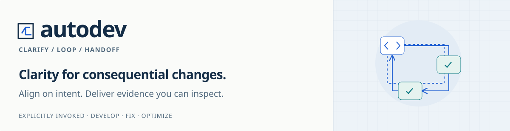
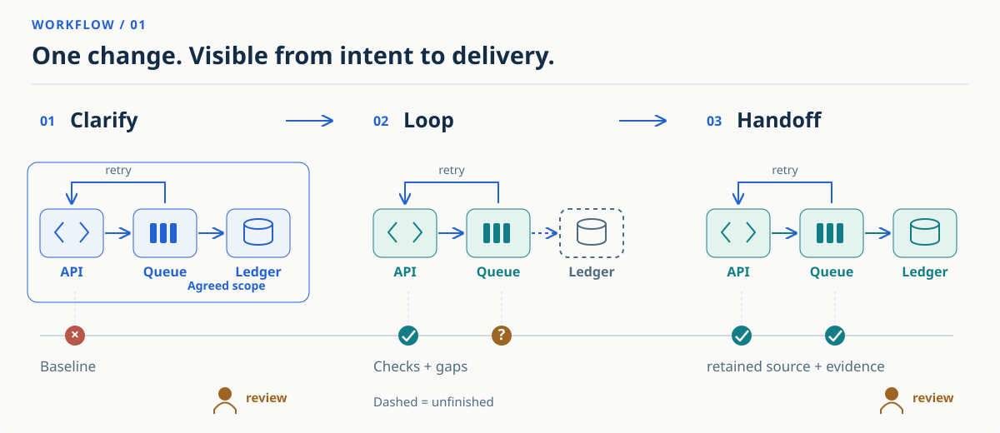
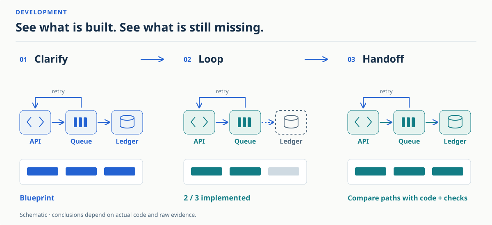
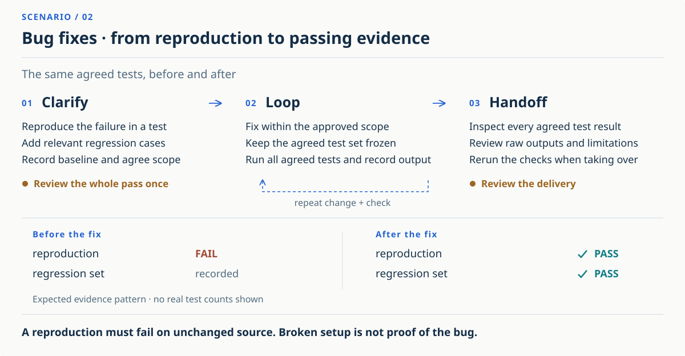
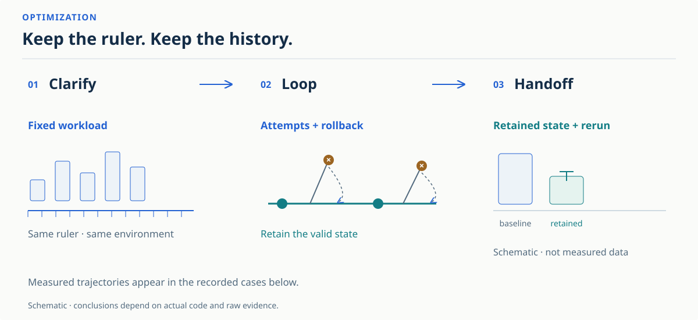

<p align="center">
  <strong>English</strong> · <a href="./README_ZH.md">简体中文</a>
</p>

<p align="center">
  
</p>

**autodev is an optional Agent Skill for complex production changes that need careful clarification, visible execution, and evidence people can inspect.**

A billing retry change can touch an API, a queue, a database, and a downstream ledger. Agreeing on a sentence is not enough: the human needs to see what will change, what is actually built, which checks support it, and what remains uncertain. autodev keeps that shared understanding through **Clarify → Loop → Handoff**, using the target project's own code, tests, and benchmarks.

```bash
npx skills add Momoyeyu/autodev -g
```

Works with agents that load `SKILL.md`. It adds a workflow and local evidence tools; it does not replace the project's development tools.

## When to use it

Use autodev when misunderstanding, hidden dependencies, or inadequate verification could make a consequential change expensive to get wrong: cross-service behavior, compatibility-sensitive migrations, payment flows, difficult regressions, or performance work with a meaningful budget and acceptance target.

A simple local quick fix normally bypasses it. Repository size alone is not a reason to use it; a small change to an idempotency boundary may warrant it. Choose according to the change's consequences and the need for shared understanding, rather than applying a ceremony to every edit.

| Fits autodev | Usually use the normal development flow |
|---|---|
| A retry policy spans billing, queue workers, and ledger writes | An obvious typo or straightforward local rename |
| An export change must preserve compatibility across modules | A small, understood change with adequate existing checks |
| A kernel optimization needs comparable measurements and a bounded budget | A speculative optimization without a useful measurement target |

## The working experience



The value is sustained understanding of the change, not a diagram at the beginning and a success claim at the end.

The same API → queue → ledger path carries through all three stages: blue marks the agreed design, green marks implemented parts, and dashed paths remain unfinished. Check records appear separately below the system state. These are workflow illustrations, not benchmark results.

| Stage | What the agent prepares or does | What the human can inspect |
|---|---|---|
| **Clarify** | Inspect the actual code; prepare the target artifact; establish baseline; propose scope and verification | The complete pass, reviewed together before implementation |
| **Loop** | Implement within the agreement, judge meaningful checkpoints, update the actual partial state | What changed, recorded checks, unfinished paths, failures, and the next action |
| **Handoff** | Verify the retained source state and prepare the required artifact with evidence and limitations | What was delivered, what was checked, what remains uncertain, and how to continue |

Clarify is practical preparation, not a questions-only stage. The agent draws from code, prepares or maintains tests, trial-runs commands, records the unchanged-source baseline, and proposes boundaries. **One human review covers the whole prepared pass**: target artifact, baseline, scope, and verification basis. The human can revise it or approve entry into Loop. Existing decisions are reused; changes to intent, target meaning, or permitted scope return to Clarify.

Loop runs in a dedicated git worktree and branch. Attempts are committed and judged with the project's agreed commands. Failing development checkpoints remain visible; invalid changes are rolled back, and rejected optimization attempts return to the retained best state. At meaningful judged checkpoints, `report --progress` writes `progress.html` with recorded checks, the current diagram when available, and remaining work. It is a snapshot refreshed by running the command again, not a streaming dashboard or a report for every tool call.

The agent can add `<contract dir>/review.md` to explain the user goal, actual progress, checked facts, evidence gaps, and next action. The page labels this as **AI review**, separate from recorded command evidence. A partial implementation stays visibly partial; failed downstream regressions and unavailable integration checks belong in the picture.

### Feature development



Prepare as-is architecture and flow diagrams from the actual code, then the proposed blueprint, build dependencies, editable scope, and regression checks. The human reviews that complete pass. During Loop, show the implemented and unfinished responsibilities and paths as they stand. At Handoff, draw as-built diagrams from the retained code and compare them with the blueprint.

A diagram node records a claim about implementation, not proof of it. An unchanged topology may correctly describe changed behavior; different IDs or different-looking pictures do not establish correctness. The agent must check the semantics against the code and supporting evidence.

### Bug fix



Prepare a reproduction that fails on unchanged source, inspect existing tests, preserve relevant coverage, repair obsolete expectations when justified, and add missing regressions. Run the agreed set for baseline, propose the impact, and present it together for human review. A broken setup is a blockage, not a reproduced bug.

Loop fixes until the agreed set passes, with test versions and raw output preserved. Explain what the tests cover and what they do not: a passing suite is evidence for its checked behavior, not a universal classification of bugs or proof that every production failure is impossible.

### Performance optimization



Prepare one executable score or fixed weighted sum, establish baseline, and propose the target, editable files, measurement conditions, and time budget for one review. Keep the ruler fixed. Loop attempts an improvement, measures it, retains the best valid state, and then checks the target or deadline. Record rejected ideas, failed attempts, and rerun results as well as improvements.

Handoff includes a chart of baseline → attempts → retained result. A timeout can end work without meeting the target. Two baseline measurements assess observed variation; they do not establish a statistical guarantee against noise. Missing measurements remain missing.

## Recorded cases

These two histories show concrete use of the optimization workflow. They are not evidence that autodev improves every task or establishes general industrial effectiveness. Both charts use recorded measurements and the skill's `autodev_render.py` renderer.

**MoE Transformer — English→French translation (PyTorch, single RTX 4090D).** Target: BLEU ≥ 28.87 (the dense reference), baseline 24.97, only `src/train.py` editable, a fixed wall-clock budget per run. Re-running the benchmark on the unchanged source moved the score by 0.62, so the improvement margin was set at 0.8. Thirty-one attempts, thirty named routes, four retained — `top1-n4`, `batch-up`, `dropout-down`, `cosine-sched` — reached 31.25; the verify re-run scored 30.91. The other routes (torch.compile, EMA, fused AdamW, capacity and depth variants…) all measured under the margin and were rolled back.


**cann2026 — rotary position embedding kernel (AscendC, CANN 9.0).** Six rounds on one editable kernel file, shown as one continuous history: attempts 1–16 follow the initial baseline at 0. All scores are recomputed from the 15 per-case raw latencies against the same fixed reference vector used in rounds 3–6, giving one shared y axis from 19.7026 to the retained 0.7168. Historical accept/reject decisions are preserved; baseline remeasurements are not counted as attempts. The dashed line marks the final round's target, 0.680, not a target shared by all six rounds. Four rounds met their own targets; rounds 2 and 6 did not. In round 6, three ideas measured under the keep margin, one attempt failed to compile and was rolled back invalid, and the retained contiguous-token change scored 0.7168 against a 0.680 target; the final verify then hit a judge-service outage, which the report records as an outage, not a number.


## Get started

Install the skill, then ask the agent to use it for a change whose consequences justify the workflow:

```text
Use autodev for our billing retry/idempotency change. Inspect the API,
queue worker, persistence, and downstream ledger flow. Prepare the current
and proposed flows, baseline checks, editable scope, and a verification plan
for one Clarify review before implementation. Preserve existing payment
compatibility and make missing integration evidence visible.
```

The agent loads [SKILL.md](autodev/SKILL.md) and the relevant references, prepares the whole Clarify pass, and presents the artifacts for review. It uses real project commands and environments. If database integration is unavailable, it records the gap and limits its claims; green unit tests do not establish database-backed idempotency.

For a running loop, the contract directory and dedicated branch hold the recorded state. A new session runs `status`, inspects the latest evidence and review notes, settles unjudged work, and continues from the next action. Optional [project constitution](autodev/references/constitution.md) rules can bind frozen paths, guard checks, and optimization budgets across rounds.

## What can be trusted

| Responsibility | Basis and limit |
|---|---|
| **Mechanical facts** | The judge records source identities, permitted scope, frozen-file checks, configured command outcomes, dependency claims, benchmark comparisons, rollback, and approval state. These facts apply to what was configured and executed. |
| **Semantic review** | The AI inspects whether code and diagrams describe the intended behavior, whether checks are adequate, and which production risks remain untested. It explains its reasoning separately from measured evidence. |
| **Human decisions** | The human reviews the prepared Clarify pass and the final evidence packet. Neither the tool nor AI review replaces those decisions. |

Nodes plus green checks are not semantic proof. An approved blueprint can be wrong; a test can miss a relevant interaction; an environment can block integration verification. autodev makes the basis and limits inspectable rather than promising a perfect protocol or production readiness.

`report` writes the final self-contained `handoff.html`: as-built diagrams for development, the agreed test results for bug fixes, or a process chart for optimization. It includes source and raw evidence, AI review when provided, and unresolved work. Blocked or partial packets can be shown, but must be labelled honestly.

Handoff approval remains separate from progress snapshots. When checks or guards are configured, approval requires successful current verification on the retained commit and a current final report. Approval binds the source, verification record, and report hash; changed source, new verification, or a changed final report invalidates it. A failed verification blocks approval. Without configured checks, the packet says verification is not configured. Merge-back and worktree cleanup follow the recorded human approval.

For instructions, see [verification](autodev/references/verification.md), [visualization](autodev/references/visualization.md), and [Handoff](autodev/references/handoff.md). Product validation, evaluation design, and research context live separately in [Product validation](docs/evaluation.md). Product usefulness comes first; a paper is an optional outcome.

## Skill structure

| File | Load when |
|---|---|
| [SKILL.md](autodev/SKILL.md) | Deciding fit and entering the workflow |
| [Clarify](autodev/references/clarify.md) | Preparing or revisiting the agreement |
| [Development](autodev/references/clarify-development.md), [bug fix](autodev/references/clarify-bugfix.md), [optimization](autodev/references/clarify-optimization.md) | Preparing the applicable target, baseline, and scope |
| [Loop](autodev/references/loop.md) | Executing the approved agreement or taking over a running loop |
| [Visualization](autodev/references/visualization.md), [verification](autodev/references/verification.md) | Showing actual states and assessing supporting evidence |
| [Handoff](autodev/references/handoff.md) | Preparing and reviewing the final packet |
| [Constitution](autodev/references/constitution.md) | Using standing project constraints |
| [Judge](autodev/scripts/autodev_verify.py), [renderer](autodev/scripts/autodev_render.py) | Running local evidence tools; use their help for command details |

Load the current stage and applicable branch, not the whole reference directory. The tools use Python 3's standard library and invoke the project's own commands; this repository does not supply a substitute workload for the user's project.

## Contributing

Keep the skill, bilingual READMEs, and diagram sources consistent. See [CONTRIBUTING.md](CONTRIBUTING.md) for regeneration and verification. Report concrete task context, observed behavior, and evidence when proposing improvements.

## License

[MIT](LICENSE)
