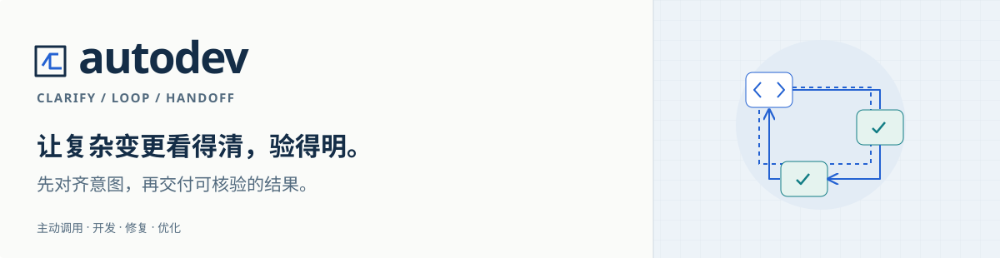
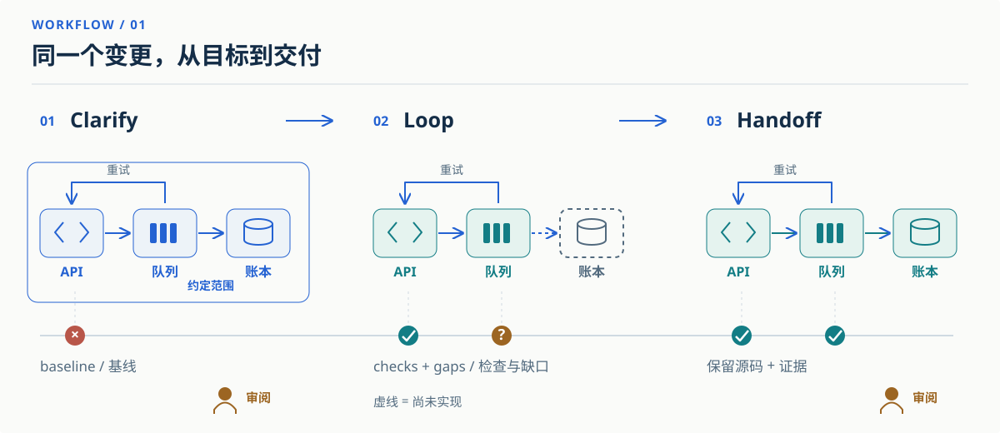
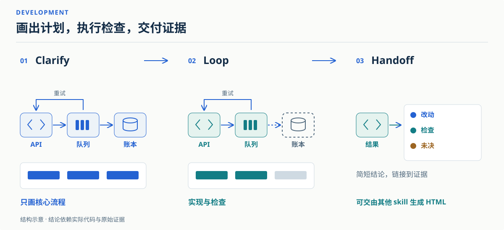
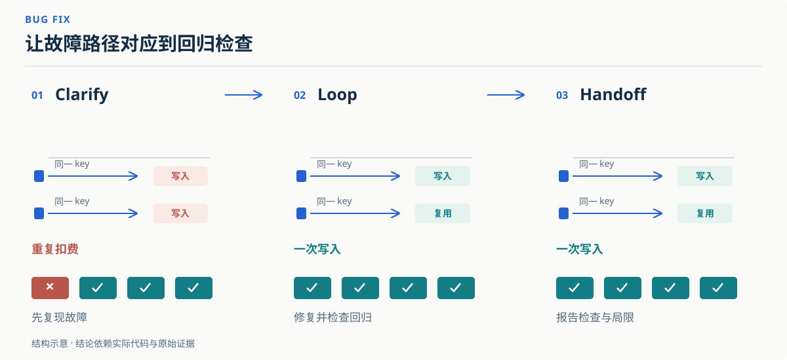
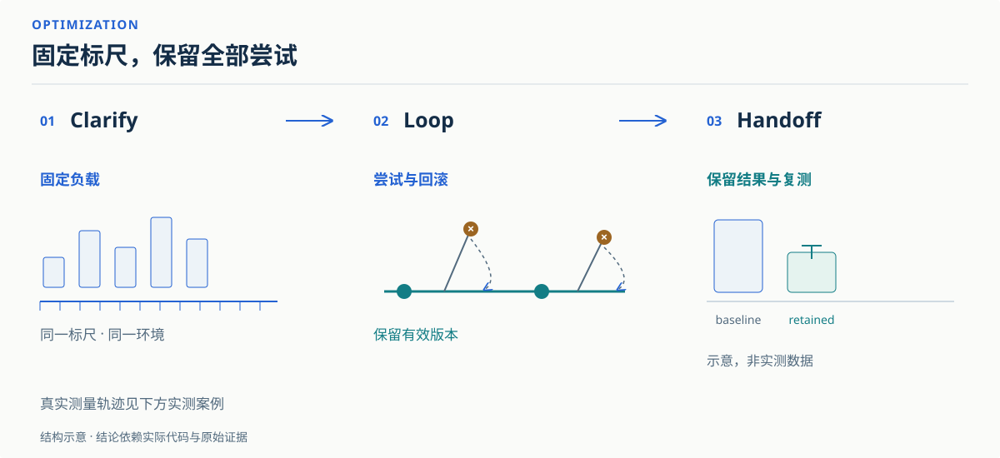
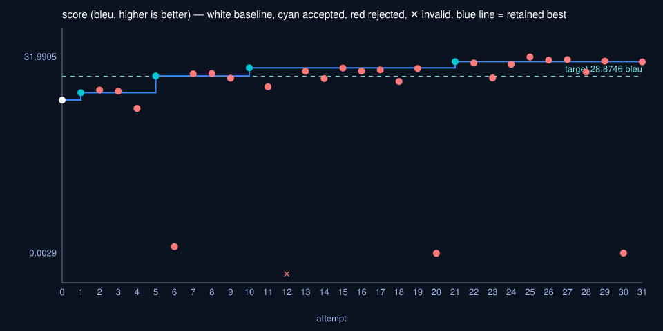
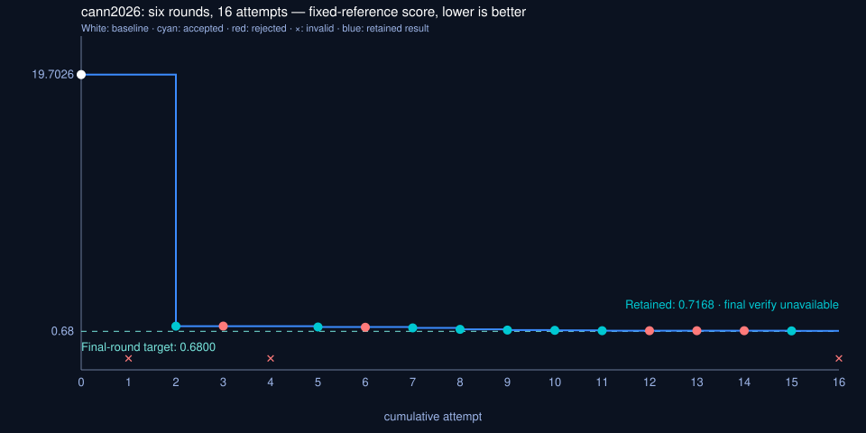

<p align="center">
  <a href="./README.md">English</a> · <strong>简体中文</strong>
</p>

<p align="center">
  
</p>

**autodev 是一个由用户主动调用的 Agent Skill：用精简的图文计划对齐意图，执行并验证，再清楚地交付结果。**

**Clarify → Loop → Handoff** 本质就是计划 → 执行 → 说明结果。主动澄清重要的不确定性，用核心流程图代替详尽蓝图，使用项目已有工具完成实现，让验证证据容易理解。

```bash
npx skills add Momoyeyu/autodev -g
```

需要这套流程时，明确告诉 Agent 使用 autodev。不能仅因为任务复杂或属于某类开发工作就自动启用。Codex 还通过 [skill 策略](autodev/agents/openai.yaml)关闭隐式调用。

## 什么时候使用

当你希望先理解变更、再判断交付是否可信时使用，例如存在重要歧义的功能、难定位的回归问题，或者需要实测的性能优化。跨模块的生产变更往往值得这样沟通；用户主动用它做小任务时，也应该只得到小计划和适量检查。

| 你的需要 | autodev 提供什么 |
|---|---|
| 功能存在重要的待定选择 | 聚焦澄清，形成简短的图文计划 |
| Bug 修复需要可信证据 | 修复前复现，修复后检查相关回归 |
| 性能改进需要实测 | 可比的 baseline、逐次测量，以及如实报告的保留结果 |

## 使用体验



| 阶段 | 做什么 | 用户看到什么 |
|---|---|---|
| **Clarify** | 检查相关上下文，澄清重要的不确定性，起草计划 | 关键选择、有帮助的核心流程图，以及少量实现与检查步骤 |
| **Loop** | 使用项目已有工具实现和验证 | 在进展、证据或方向变化时给出简短更新 |
| **Handoff** | 说明交付结果与支撑证据 | 重要变化、实际检查结果、尚存限制和有用链接 |

沿用已有指令与决策。任务已获授权时，制定计划后即可继续，不额外增加形式性的批准关卡。新发现的选择如果影响目标、兼容性、显著成本或不可逆操作，再与用户对齐。

在用户选定的目录中工作。Git、分支、提交和 worktree 都是可选的项目选择。Autodev 不再附带执行契约引擎、冻结文件登记、强制报告格式或专用运行环境。

### 功能开发



先给一份能扫读的草稿：目标、关键约束、一张小型流程图或组件图，以及少量步骤。Mermaid 通常就够了，格式保持灵活。Agent 先调查代码能回答的问题，再询问重要的不确定性。思路变化时更新图示，不维护三份完整的架构文档。

验证跟着变更的风险走。计费重试改造可能需要重复请求检查和账本集成证据，小型 UI 改动可能只需一次交互检查。图解释预期行为，实际检查支撑实现结论。

### 问题修复



优先在修改实现前得到一个有针对性的失败复现，然后修复并检查相关回归。难以自动化时，记录可靠的手动复现。区分真正的缺陷与 fixture、环境故障，并解释测试预期的变更。详见 [Bug 修复与 TDD](autodev/references/clarify-bugfix.md)。

### 性能优化



先测有意义的 baseline，保持工作负载和测量条件可比，每次尝试回答一个具体假设。保留有证据支持的改进，也保留失败和被拒绝的尝试记录。沿用用户预算，为开放式搜索设定边界，目标达到或继续尝试已无价值时结束。短比较用表格即可，长历史可以用图表。详见[性能优化](autodev/references/clarify-optimization.md)。

## 实测案例

这两段历史记录于旧版优化工作流。保留原始实测图表，但它们不能证明当前 skill 对所有任务都有提升，也不能建立普遍的工业有效性。

**MoE Transformer —— 英译法翻译模型（PyTorch，单卡 RTX 4090D）。** 目标：BLEU ≥ 28.87（dense 参照值），baseline 24.97，只允许修改 `src/train.py`，每次运行固定墙钟预算。benchmark 在未改动的源码上复跑，同一份代码两次成绩相差 0.62，改进余量因此定为 0.8。31 次尝试、30 个思路标签、4 次被保留——`top1-n4`、`batch-up`、`dropout-down`、`cosine-sched`——达到 31.25；verify 复测 30.91。其余思路（torch.compile、EMA、fused AdamW、容量与层数变体等）测量全部低于余量，逐一回滚。



**cann2026 —— rotary position embedding kernel（AscendC，CANN 9.0）。** 对同一个 kernel 文件跑了六轮，图中是一条连续轨迹：初始 baseline 为第 0 点，16 次尝试接着编号。所有分数都从 15 个用例的原始耗时出发，按第 3–6 轮使用的同一组固定参考耗时重新计算，共用一条 y 轴，从 19.7026 到最终保留的 0.7168。保留当时的接受／拒绝判定，baseline 复测不计为新尝试。虚线标注最后一轮的目标 0.680，不代表六轮共用这个目标。四轮达到各自目标，第 2、6 轮未达标。第 6 轮里 3 个思路测量低于保留阈值，1 次尝试编译失败被判无效并回滚，保留的连续 token 分块优化拿到 0.7168（target ≤0.680）；最后 verify 撞上评测服务宕机，报告里记录的是宕机，不是一个编出来的分数。




## 快速开始

```text
用 $autodev 做计费重试改造，保持已有支付兼容性。
澄清重要的待定问题，给一份精简的核心流程计划，然后实现并检查。
最后简短交付，明确指出缺失的集成验证证据。
```

Agent 加载 [SKILL.md](autodev/SKILL.md)，仅在需要时读取 Bug 修复或性能优化参考。沿用项目已有指令、测试与工具。长任务或接管场景可以留下持久笔记，但不要求独立的产物目录。

## 可选的 HTML 交付

默认在对话中简短交付，或沿用项目已有格式：改了什么、检查了什么、还有哪些不确定性，并给出有用链接。不打开报告也应该能读懂。

希望看可视化页面时，可以明确提出，并选择渲染 skill。[Archify 的 explainer](https://github.com/tt-a1i/archify/blob/main/archify/SKILL.md)支持结论先行的 HTML 页面；[visual-explainer](https://github.com/nicobailon/visual-explainer)适合视觉解释、变更审阅和项目回顾。Autodev 提供经过核实的内容，再交给所选 skill；两者都不是必需依赖。

```text
用 $autodev 实现这个改动。最终交付时，用 Archify
把结果、实际检查和限制整理成一个精简的 HTML explainer。
```

## 如何理解证据

只报告实际执行过的命令与结果，把实测观察和 AI 推断分开。明确标注既有失败、跳过或无法运行的检查，以及未完成的工作。单元测试通过，不能证明从未检查过的集成性质。

Skill 提供工作指引，不机械证明正确性，也不保证开发更快。[产品评估](docs/evaluation.md)关注澄清、图示与交付是否确实帮助了用户，足以抵偿流程成本。

## Skill 结构

| 文件 | 用途 |
|---|---|
| [SKILL.md](autodev/SKILL.md) | 主动调用边界，以及完整的 Clarify → Loop → Handoff 流程 |
| [Bug 修复与 TDD](autodev/references/clarify-bugfix.md) | 复现、回归覆盖与证据边界 |
| [性能优化](autodev/references/clarify-optimization.md) | 可比测量与有边界的实验 |
| [Codex 策略](autodev/agents/openai.yaml) | 关闭隐式调用 |

## 参与贡献

保持 skill、中英文 README 与图示源文件一致。重新生成与检查方法见 [CONTRIBUTING.md](CONTRIBUTING.md)。改进建议应附带具体使用中的摩擦与证据。

## 许可

[MIT](LICENSE)
